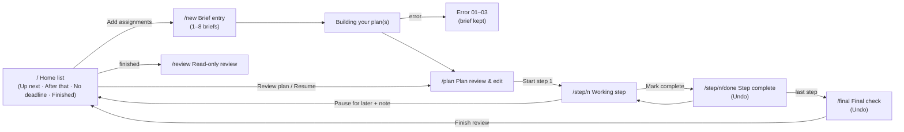

# Momentum: case study (first draft)

> **Draft status (2026-11-19).** Written from the repository docs (`docs/decisions.md`, `docs/status.md`, `docs/reviews/`, `docs/evidence/`, `docs/m7-plan.md`, `PRODUCT.md`, `DESIGN.md`, `FEATURES.md`) and the project files (handoff, Revision 2 review). Nothing here was invented.
>
> - `[AIDAN: …]` marks something only you can supply or confirm.
> - `[PENDING: …]` marks evidence that does not exist yet (participant sessions, VoiceOver, real-model weekly run). **Do not submit with these unfilled.**
> - `[SHOT: …]` marks a screenshot slot. The full list, with what exists, is at the end.
> - Written in your voice (first person). Rewrite anything that doesn't sound like you.

**Links:** product https://momentum-five-xi.vercel.app · code https://github.com/Aidan-OD-tech/momentum · Figma https://www.figma.com/design/cMfSfGqzvhUCPpCW0LwGaI/Momentum-v2

---

## 1. Context and problem

**Path:** Continue Project 1. `[AIDAN: confirm. This draft assumes Momentum v1, the original wireframe and the "Core flow — review set" in Figma, was your Project 1. If Project 2 is formally "Build Something New", use the alternative paragraph in the box below and drop the before/after slots.]`

**Role:** sole designer and front-end developer. I owned the product and design decisions, wrote the milestone task briefs, and reviewed, tested and merged every change. Implementation was done with an AI coding assistant (see section 6).

**Audience:** students who are already committed to an assignment but find it hard to start or to come back to. They often feel overwhelmed or have been putting it off, work in short interrupted sessions (sometimes days apart, sometimes late at night near a deadline), and usually have the brief open in a split screen beside Google Docs or Word.

**The need.** An assignment brief is dense: the actual question, a word range, source requirements, citation style and the submission rules are mixed together, and the most important line (the due date) is often at the bottom. The hard part isn't the writing tools; it's turning that page into a first action, and later remembering where you were.

**What people do instead.** `[AIDAN: replace or confirm with what you actually observed or did yourself. Don't cite anything you can't back up.]` Typical workarounds are re-reading the whole brief every time, a to-do list in a notes app, a Pomodoro timer, or a general AI chat asked to "break this down". Each solves part of it: a to-do list doesn't know the brief's requirements, a countdown adds pressure, and a chat answer scrolls away and doesn't remember which step you stopped on.

**Why build it.** Momentum keeps the plan, the brief and the student's own return notes in one calm place, so coming back takes one glance instead of a re-read.

**Intended outcome.** A student who arrives with a brief can identify and begin the next action without help, and after a pause returns to the right step with their context intact.

**Scope and constraints that shaped it**
- Individual course project, built over a short window (the implementation handoff is dated Nov 17, 2026; the core flow, AI generation, evaluation fixes and multi-assignment support were merged Nov 17–19).
- Ryan's early feedback: keep it focused, make the actionable step prominent, make the timer less prominent, keep the original brief reachable, generate the plan once and then work from structured data, use browser storage, and **defer calendars, time analytics and multiple-assignment management**.
- No accounts or database: everything is stored in the student's browser. The only server work is the plan-building request, so the API key never reaches the browser.
- Momentum never sees the student's document and never submits anything. That limit shaped a lot of the copy.
- Desktop first (designed at 1440, checked at 1280×800), but usable in a half-width window (~600 px) because of the split-screen use.

> **Alternative for "Build Something New"** `[use instead of the "Path" line if needed]`
> Path: Build Something New. Momentum started from a user need, not an existing product: students who stall at the start of an assignment and lose their place after a break. The idea went from an initial wireframe and review set, through two Figma revisions and an implementation handoff, to a deployed, tested app. Section 3 shows that development.

`[SHOT: P1 original — the Project 1 version of the core screen, for before/after (Continue path only)]`

---

## 2. Research and findings

Findings came from four sources. I've kept them separate because they carry different weight.

### 2.1 Instructor feedback (Ryan)
Ryan judged the idea feasible and pushed for one assignment flow done well. His points became design requirements (section 3). Instructor feedback supports the direction; it isn't evidence that students find the product useful.

### 2.2 Heuristic evaluation (Nielsen's 10)
- **Method:** a walkthrough of every screen on a production build at 1280×800 and 600×800, plus a "risk" review of saving and pausing and a "signal" review of copy and status messages. Severity on Nielsen's 0–4 scale.
- **Who:** the first draft was an AI expert review written by Claude Code; I reviewed it, set the severities I disagreed with, and decided what to fix. One of the two most serious findings (H-17) I found myself in a walkthrough. Full table: `docs/evidence/heuristic-evaluation.md`.
- **Result:** 17 findings. Two severity 3 (major), eight severity 2, seven severity 1.

| ID | What was wrong | Sev. | Outcome |
| --- | --- | --- | --- |
| H-01 | A second Momentum tab could overwrite the first tab's saved note while still showing "Saved in this browser" | 3 | Fixed: tabs now sync through the browser's `storage` event |
| H-17 | *(found by me)* Opening a done step from the step list hid the step in progress and left no way back | 3 | Fixed: the list always shows the step in progress, the done view has "Back to step N", the wordmark links home |
| H-02 | Pasting more than 12,000 characters silently cut the end of the brief, where due dates usually are | 2 | Fixed: says the text was cut |
| H-03 | The rate-limit error said "try again in a moment" when the wait could be 10 minutes | 2 | Fixed: honest wait line |
| H-05 | The model was told "today" in UTC, so "due this Friday" could resolve a day off in a US evening | 2 | Fixed: the browser's local date is sent |
| H-08 | Text-field borders were 1.48:1 against white (WCAG 1.4.11 needs 3:1) | 2 | Fixed: 3.03:1 |
| H-09 | The save-failure message was a small caption, not announced to screen readers | 2 | Fixed: live region and icon |
| H-04 | Generated time estimates ran about twice the hand-written plan's (≈6.5 h vs 3 h 20 min) and might feel daunting | 2 | Watch in sessions |
| H-07 | "Start step 1" sits about 1,315 px down plan review at 1280×800 | 2 | Watch in sessions |

What already worked (kept deliberately): one primary action per screen; "Saved in this browser" only after a confirmed write; no fake progress stages while the plan builds; the paused home leads with "Pick up where you left off" and the note; every error keeps the student's brief.

`[SHOT: heuristic evidence — e.g. the two-tab bug or the done-step dead end, before and after]`

### 2.3 Accessibility pass (target WCAG 2.2 AA)
- Automated (axe-core) on 17 views at 1280×800 and 600×800: **0 violations** after the M6 fixes. The weekly-upload screens added in M7c also returned 0.
- Keyboard: a scripted pass through the whole flow found no traps and a visible focus indicator on every stop. It was scripted key presses, not a person at a keyboard.
- `[PENDING: VoiceOver pass. The script is written (VoiceOver step 7 = "Progress saved"). Until it's run, say screen-reader support is untested.]`

### 2.4 Task-based feedback from participants (course requirement: ≥2 people)
`[PENDING: sessions not yet run. Nothing below may be filled in until they have been.]`

- **Who:** `[P1, P2 (codes only), and how they match the audience]`
- **Build tested:** production, with "Use a sample brief" hidden so participants paste a real brief.
- **Tasks** (from `docs/evidence/feedback/session-guide.md`):
  1. Turn a brief into a plan and identify the next action.
  2. Pause with a note, return, and resume the correct step.
  3. Complete the flow and explain what the final check does and doesn't establish.
  4. `[PENDING: weekly-upload task, to be added to the guide in M7d: add several briefs and say which assignment to work on first and why]`
- **Observations and patterns:** `[from P1/P2 files only; link each to a heuristic ID or add a new one marked "(Aidan, from P1)"]`
- **Watch-list items to check:** did anyone hesitate at the long plan review (H-07), react to large time totals (H-04), assume their progress synced across devices (H-15), or misread the final check as verification?
- **What I learned:** `[PENDING]`

---

## 3. Design decisions

The design went from an original wireframe and Figma review set, to "Core flow — revision 2", to Revision 3 refinements written into an implementation handoff, then into code in small milestones. New design work after the handoff went on a separate Figma page ("Design additions (post-R3)") so the earlier flows stayed intact as a record.

`[SHOT: Figma R2 working step (Core 01) next to the built working step at 1280]`

**1. One next action, and the step itself is the hero.**
Each screen has one primary button. On the working step the title is set large (Display), "What to do" and "Done when" follow, and Mark complete was kept within the top ~664–700 px so it's visible on a 1280×800 laptop without scrolling. *Why:* the audience arrives overwhelmed; Ryan asked for the actionable step to be prominent.

**2. The timer is optional, off by default, and never completes a step.**
*Why:* Ryan asked for less timer prominence, and Pomodoro-style countdowns were an explicit anti-reference. Hiding the timer doesn't pause it; nothing punishes a pause.

**3. Return context comes first.**
Pausing asks for an optional note ("Where did you leave off?"). Coming back, home leads with "Pick up where you left off", the step and the note. Notes belong to individual steps; hiding a note never deletes it; closing the pause dialog keeps a half-typed draft, even across a refresh (a recommendation I accepted before build).

**4. Say only what's true.**
- "Saved in this browser" appears only after a successful write. If storage fails, the app keeps working in memory and says "Couldn't save in this browser".
- Building the plan shows one honest "Building your plan" state, not a staged checklist, because the model returns everything at once. Revision 2 had drawn stages; the handoff replaced them.
- The final check carries the brief's substantive requirements (e.g. "takes a clear position…") as well as format, is described as the student's own review, and the end screen says Momentum doesn't submit or verify anything.
- The brief-entry disclosure: "To build your plan, your brief is sent to OpenAI. Your plan and progress stay in this browser. No account needed."

**5. Mistakes are recoverable.**
Step completion has Undo, including from the final check (I asked for this; it was drawn as Figma frame "A1 · Final check — undo last step" before it was built). Errors keep the brief text. Editing requirements updates the final checklist but never silently rewrites the steps; a notice tells the student to check their steps still fit.

**6. Scope cuts I accepted from a structured scope review** (`docs/reviews/2026-11-17-scope-m3-m4.md`): no regenerate button, no step reordering, no editing the plan after starting, no automatic retry; one date field; one shared error card. I kept "Use a sample brief" against that review's advice for development, then hid it behind a flag for testing.

**7. Several assignments at once (M7). My decision, reversing earlier advice.**
After the single-assignment flow was working and evaluated, I decided a student should be able to add a week's briefs on a Sunday and see a home list ordered by what's most pressing. This reverses Ryan's advice to defer multiple-assignment management and the MVP's own "Out" list. **It was my idea, not a participant finding.** `[AIDAN: one or two sentences on why you made the call: what convinced you that one-assignment-at-a-time didn't match how students actually work?]`
- *How I kept it in character:* still "a calm page, not a dashboard". No calendar, no analytics, no urgency colors. A passed deadline just reads "Due date passed", with no red and no icon.
- *Ordering:* deadline first (date-only deadlines count as end of day); same deadline → more work left first; no deadline → oldest plan first; finished assignments in a quiet list below. I rejected a "start-by" or slack score (deadline minus remaining work) because it would depend on the model's estimates, which the evaluation found run about twice the hand-written plan's (H-04). A list that reshuffles as estimates change is harder to trust than "due soonest first".
- *Weekly upload:* one plan request per brief, one at a time, each with its own honest status (waiting, building, ready to review, couldn't build), so one bad brief can't fail the whole week. Up to 8 briefs. The per-IP limit went from 5 to 12 per 10 minutes to fit a week's upload.
- *Process:* I drew the M7 frames (home list, weekly upload, building several plans, assignment row) on the post-R3 Figma page before building, then a risk review of the upload flow found 12 issues; I chose to fix 8 before merging and deferred 4.

`[SHOT: Figma M7-1 home list draft next to the built home list]`

---

## 4. Final experience and implementation

### 4.1 The core flow
`[SHOT: one image per step below, 1280×800]`

1. **Brief entry.** Paste a brief (or several), with an optional deadline. Character count, honest limit messages, the OpenAI disclosure.
2. **Building your plan.** One indeterminate state, ~10–14 s in testing, with Cancel. Three error states: nothing entered, a brief that doesn't read like an assignment (e.g. a recipe), and a build that failed (with an honest wait for the rate limit).
3. **Plan review.** Summary, requirements as chips, steps with approximate estimates and "Done when". Everything is editable before starting.
4. **Working step.** Step list on the left, the step on the right, "From your brief" requirements, optional timer, Mark complete / Pause for later. Full plan and original brief open in a side panel.
5. **Pause and return.** Optional note → home shows "Pick up where you left off".
6. **Step complete.** "Step N done." with Undo and the next step.
7. **Final check.** The brief's requirements as a checklist that the student ticks, plus the submission reminder ("Momentum doesn't submit anything for you").
8. **Home list.** Up next card (the top of the priority order), then "After that", "No deadline" and "Finished"; a completion line after finishing an assignment.

### 4.2 Information architecture
Organized around one question: *what do I do next?* The home list answers it across assignments; the working step answers it within one.

`[AIDAN: keep the diagram only if it helps; the brief says "a diagram only when it helps". A cleaner version could be drawn in Figma or Lucid.]`

Two relationships worth explaining in the writeup:
- **One open assignment.** Screens after home act on whichever assignment is "open"; choosing one on the home list opens it. This kept every existing screen unchanged when M7 added several assignments.
- **Step state.** Each step is upcoming, in progress or done, and carries its own note and hidden-note setting. Home, the step list and the final check are all views of that same data.

### 4.3 Reusable components
Design tokens (colors, type, spacing, radii, focus ring) live in one CSS file named after the Figma variables, mapped into Tailwind. Accessible primitives come from Radix through shadcn/ui, **restyled to Momentum's tokens** rather than shadcn's default look (button, dialog/side sheet, checkbox, tabs, collapsible, text field). Momentum's own components are built on those, for example `TopBar` (with the save status), `StepRail`, `WorkingStep`, `DoneWhen`, `ReturnNote`, `Timer`, `PauseDialog`, `PlanStepRow`, `StepEditCard`, `RequirementsEditCard`, `ErrorCard` (shared by two error screens), `UpNextCard` and `AssignmentRow`. Each maps to a Figma component or frame.

`[SHOT: Figma component (e.g. Timer states or Return note v2) beside the built component]`

### 4.4 Technical choices that mattered
- **Next.js / React / TypeScript.** Routes per screen (`/plan`, `/step/n`, `/final`, …) so the browser's back button and links work.
- **Browser storage only**, under one key. If stored data can't be read it is copied to a backup key before anything else, so a bad load never overwrites the student's data. Tabs stay in sync through the `storage` event (the H-01 fix).
- **AI plan generation on the server.** The brief goes to OpenAI through `POST /api/plan` with structured output; the response is validated against a schema before it becomes a plan. After that, everything (editing, navigation, notes) runs from stored data with no further model calls, as Ryan recommended. The API key is read only in server code, and a build check fails if a key or the OpenAI address ever reaches browser files.
- **Cost and abuse guards:** brief length limit checked on the server, per-IP and global rate limits, a 45 s timeout, and a monthly budget cap on the OpenAI project as the hard limit.
- **Weekly upload queue:** one request at a time from a provider that sits above every screen, so the queue keeps running while the student goes back to the home list.
- **Testing:** 367 automated tests (Vitest) at the M7c merge, plus scripted browser walkthroughs, axe and keyboard scripts saved under `docs/evidence/test-results/`.

### 4.5 How usability findings changed the build
Seven heuristic findings were fixed in one milestone (M6), one commit each, with tests (table in 2.2). `[PENDING: add any changes made because of the participant sessions; if none were needed, say that.]`

---

## 5. Outcomes and measurement

### 5.1 What the working build demonstrates (observed)
- The whole flow works on the deployed product, from a pasted brief to a finished final check, and across several assignments.
- In developer checks against the live model, 9 of 9 real briefs produced plans in 10.0–13.9 s, and a non-assignment (a recipe) was refused in about 3 s with the brief kept. These are developer checks, not user research.
- 0 axe violations on every screen at both widths; no keyboard traps.
- `[PENDING: what participants did. For each: built a plan? started step 1 without help? paused and resumed the right step?]`
- `[PENDING: one real-model run of a 3-brief weekly upload on production (M7d).]`

### 5.2 Success measure
**Primary:** the share of created plans where step 1 is started in the same browser within 15 minutes of the plan being created. That's the closest the product can get to "identified and began the next action without help". 15 minutes leaves time to read and edit the plan; a later start most likely means the student left and came back.

**Complementary (not instrumented):** the share of paused steps the student later resumes. Observed in sessions only.

### 5.3 The instrumented event
`first_step_started`, sent once per plan the first time Start step 1 is pressed, from production builds only. It carries two values and nothing else: a time band since the plan was created (`<2`, `2–5`, `5–15`, `>15` minutes) and the plan's step count. No brief text, IDs, timestamps or IP address. Because the project is on Vercel's Hobby plan (custom analytics events need Pro), it posts to Momentum's own `/api/event`, which writes one log line. Denominator: the plan-created log lines.

**Limits I'd state plainly:** it counts browsers, not people; pressing Start isn't doing work; Hobby keeps logs for 1 hour, so durable post-launch numbers would need Vercel Analytics (Pro) or a log drain.

### 5.4 Observed vs. after launch
| | Source | Status |
| --- | --- | --- |
| Observed in sessions | Facilitator notes + the event lines copied live | `[PENDING]` |
| After launch | Event counts by time band ÷ plans created | Not gathered; would need durable logging |

### 5.5 How results would guide changes
| If… | Look at | Possible change |
| --- | --- | --- |
| Few plans lead to a start | Do people scroll or hunt on plan review? (H-07) | Bring Start step 1 into view |
| Starts happen but late | Do large estimate totals put people off? (H-04) | Prompt for a smaller first step; lead with step 1's own estimate |
| People re-open the original brief a lot | Is the plan trusted? | Show where each requirement came from |

### 5.6 Before and after `[Continue path only]`
`[SHOT: P1 original vs. final, same task, side by side, with one line on what changed and why]`

---

## 6. Reflection and ownership

**What worked** `[AIDAN: edit]`
- Building in small milestones, each with a written brief, acceptance criteria, a branch and a pull request, kept every change reviewable. Nine PRs were merged.
- Getting the whole flow working on sample data before adding AI meant the model only had to fill in a data shape the screens already handled.
- Writing the "say only what's true" rule down early (PRODUCT.md) made a lot of copy decisions easy.

**What I learned** `[AIDAN: in your own words, e.g. about honest status copy, about state/persistence edge cases like two tabs, about scoping]`

**Remaining limitations**
- `[PENDING]` Participant sessions and the VoiceOver pass (update this list after them).
- Everything lives in one browser: no sync, and clearing site data or a lab computer that wipes loses it.
- Two tabs on *different* assignments: after a reload, whichever tab wrote last decides which one opens.
- Reloading during a weekly upload stops the queue (the unbuilt briefs are kept as drafts).
- The rate limiter is in memory, so on Vercel it's per server instance: best effort, not a guarantee. The OpenAI budget cap is the real limit.
- Generated estimates vary between runs and ran about twice the hand-written plan.
- Four risk-review items deferred (M8).

**What I'd improve next:** the session findings first; then the M8 items; then, if the measure is low, bringing Start step 1 into view on plan review.

### AI disclosure
`[AIDAN: check every line; correct anything that over- or under-states your part.]`
- **Claude Code** (in VS Code, on my machine) wrote the application code, tests and repository docs from milestone briefs I approved. It also ran the automated test, accessibility and browser scripts, and drafted the heuristic evaluation and the risk/scope reviews.
- **Claude, in a planning project**, helped me plan milestones, write those briefs, review branches, and draft this case study. `[AIDAN: also the presentation deck, if you want to say so.]`
- **`/craft`**, Ryan's skill, used for structured scope, risk, signal (copy/status), compose and responsive reviews.
- **OpenAI** (`gpt-6.1-terra`) is part of the product: it turns a brief into a plan.
- `[AIDAN: how the Figma revisions, the Revision 2 review and the implementation handoff were made, and with what tools.]`

**Decisions and corrections I made** (recorded in `docs/decisions.md` and `docs/evidence/ai-log.md`):
- Chose the stack and that shadcn's default look must not be used.
- Asked for Figma copy instead of placeholder text, and the larger Display style for the step title.
- Turned off Next.js Cache Components after invalid URLs returned 200 instead of 404.
- Found H-17 (the done-step dead end) myself and set it to severity 3; confirmed H-01 as severity 3.
- Narrowed an AI-proposed rule that dropped any "Submit…" step, so interim deadlines (like a draft for peer feedback) aren't lost.
- Asked for an environment tag on the event so test traffic can be excluded.
- Decided on multi-assignment support (M7), against earlier advice, and wrote my own version of a risk fix (removed briefs count toward the 8-brief limit).
- Approved or rewrote the user-facing wording flagged as "development copy".
- Corrected factual errors in AI-drafted presentation notes (e.g. test counts, which tools were project dependencies).

**What I'd struggle to explain or reproduce** `[AIDAN: be honest here; the brief asks for it. Candidates to consider: the build-queue provider, the storage backup and tab-sync logic, the server's structured-output parsing, the `WhenLoaded` pattern that keeps 404s correct.]`

I remain responsible for this work and can explain and modify it.

---

## Screenshot checklist

**Already in the repo** (`docs/evidence/screenshots/`):

| Use in section | File(s) |
| --- | --- |
| 4.1 brief entry | `m6-brief-entry-1280.png`, `m6-brief-entry-over-limit-1280.png` |
| 4.1 several briefs | `m7c/m7c-entry-three-briefs-1280x800.png` |
| 4.1 building | `m6-building-1280.png`, `m7c/m7c-building-mid-run-1280x800.png`, `m7c/m7c-building-with-failure-1280x800.png` |
| 4.1 errors | `m6-error-01-1280.png`, `m6-error-03-rate-limit-1280.png`, `m4-error02-recipe.png` |
| 4.1 plan review / edit | `m6-plan-review-1280.png`, `m6-plan-review-edit-1280.png` |
| 4.1 working step | `m5-working-step-1280.png` (pre-M6), `m6-working-step-600.png` |
| 4.1 pause + return | `m6-pause-dialog-1280.png`, `m6-home-after-pause-1280.png` |
| 4.1 step complete | `m6-step-complete-1280.png` |
| 4.1 final check | `m6-final-check-1280.png` |
| 4.1 home list | `m7c/m7c-list-after-1280x800.png`, `m7c/m7c-list-while-building-1280x800.png` |
| 2.2 H-17 fix | `m6-done-step-1280.png` |
| 2.2 H-02 / H-03 fixes | `m6-preview-paste-13000.png`, `m6-error-03-rate-limit-1280.png` |
| 2.2 save failure (H-09) | `m6-save-failed-600.png` |
| Narrow window | `m6-*-600.png`, `m7d/*-375.png` / `-600.png` (untracked, from M7d in progress) |
| 3 Figma reference | `/mnt/project-files/handoffs/m2-figma-reference/*.png` (Core 01, Core 05, A1 undo, component sets) |

**Still needed:**
1. `[AIDAN]` Project 1 original screens (before/after, Continue path only).
2. Home list at 1280 with **real** generated plans (current list shots use stubbed plans that reuse the sample's course and deadline) — from the M7d production run.
3. A working step at 1280 from the M6+ build (the existing 1280 one is from M5, before the field-border and save-status fixes).
4. Figma M7 frames (M7-1 home list, M7-2 weekly upload) exported for the decision section.
5. Session evidence (photo of notes or a redacted screen, no faces or names without consent) `[PENDING]`.
6. Optional: before/after of the two-tab bug or the done-step dead end, for 2.2.

## Before submitting
- [ ] Confirm the project path and delete the unused paragraph.
- [ ] Run ≥2 sessions and fill every `[PENDING]`.
- [ ] VoiceOver pass.
- [ ] Update README: it still says the current milestone is M6.
- [ ] Trim to "concise": the brief asks for a visual case study, so most of 4.1 should be images with one-line captions.
